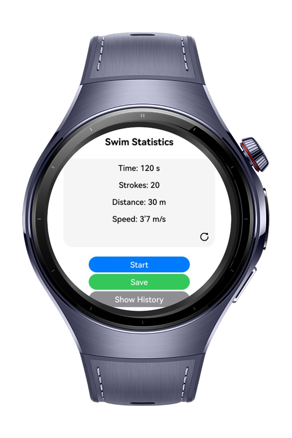

> **Note:** To access all shared projects, get information about environment setup, and view other guides, please visit [Explore-In-HMOS-Wearable Index](https://github.com/Explore-In-HMOS-Wearable/hmos-index).

# SwimStatistics

Swim Tracker Wear is a HarmonyOS NEXT application that allows users to track their swimming workouts directly from their smartwatches. The app uses Wearable @ohos.sensor and @ohos.resourceschedule.backgroundTaskManage technologies to detect metrics such as distance, lap count, pace, and calories during swimming sessions. Users can access their training history directly on their watch.

The application features a swim-focused interface and is specifically optimized for HarmonyOS-powered smartwatches. Touch interactions are minimized during pool activity to ensure an uninterrupted training experience.
# Preview

<div>
  
</div>

# Use Cases

- **Splash Page**: Displays the app logo and initializes sensor and permission services on launch, ensuring a smooth and fast startup experience on HarmonyOS wearable devices.
- **Swimming Tracker Page**: Tracks laps, distance, duration, and pace in real time using wearable motion and sensor data, while minimizing on-screen interactions during swimming.
- **Swim History & Records Page**: Shows past workout sessions in a scrollable card-style layout, allowing users to review metrics such as total distance, session time, and performance trends directly on the watch.
- **Responsive & Scrollable UI**: Clean card-style design optimized for HarmonyOS devices with smooth scrolling.

# Tech Stack

- **Language**: ArkTS (Ark TypeScript)
- **UI Framework**: ArkUI Declarative Framework
- **OS**: HarmonyOS NEXT (API 18)
- **Libraries**:
    - `@kit.AccelerometerSensor`
    - `@kit.BackgroundTaskManager`
    - `@kit.DatabaseHelper`
    - `@kit.lottie`

# Directory Structure
```
├── core
    ├── model
    │     └── SwimRecord
    ├── util
    │     └── ConstantUI
    └── pages
          └── DetailPage
          └── HistoryPage
          └── Index
          └── SplashPage


```
# Constraints and Restrictions

- Access to notes is restricted to authorized locations defined by the application.
- Notes cannot be accessed or exported outside the defined geofence.
- Persistent storage is encrypted; no plaintext copies are stored locally.
- Requires user permission for location access.

## Supported Device

- HarmonyOS NEXT Devices (Smartphones or Tablets)
- API Level 18 and above

# LICENSE

Location Based Secure Vault is distributed under the terms of the MIT License.

See the [LICENSE](./LICENSE) for more information.
